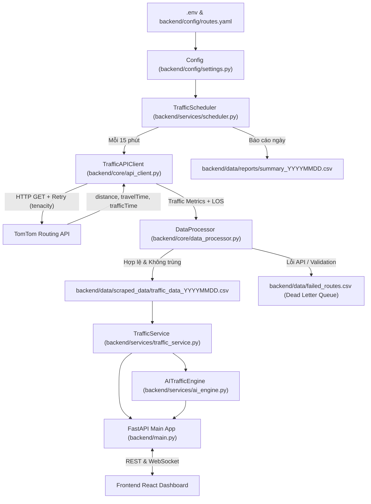

# Tài Liệu Kỹ Thuật — HCM City Traffic Intelligence Backend (`backend`)

Tài liệu này mô tả kiến trúc hệ thống hợp nhất, luồng xử lý dữ liệu, đặc tả các module, cấu hình, cơ chế xử lý lỗi và hướng dẫn vận hành cho toàn bộ hệ thống backend.

---

## 1. Tổng quan & Kiến trúc hệ thống

Toàn bộ dịch vụ backend được hợp nhất trong thư mục `backend/`, bao gồm:
1. **Dịch vụ Thu thập Dữ liệu (Scraper Service)**: Tự động gọi **TomTom Routing API v1** định kỳ mỗi 15 phút trên 10 tuyến đường trọng điểm tại **TP. Thủ Đức, TP.HCM**.
2. **Dịch vụ API & Streaming (FastAPI + WebSocket)**: Cung cấp REST endpoints cho Frontend và stream dữ liệu thời gian thực qua WebSocket.
3. **Mô hình Dự báo AI (AI Forecasting Engine)**: Tính toán dự báo vận tốc, thời gian di chuyển và cấp độ dịch vụ (LOS A-F) cho các mốc thời gian **+15, +30, +45 phút**.

### Luồng xử lý dữ liệu (Data Flow)



---

## 2. Đặc tả chi tiết các Module trong `backend/`

### 2.1. `backend/config/`
* **`settings.py`**: Nạp `.env`, xác thực `TOMTOM_API_KEY`, đọc `routes.yaml`, tự động tạo các thư mục `data/` và `logs/`.
* **`routes.yaml`**: Định nghĩa tọa độ điểm đầu, điểm cuối, chiều dài của 10 tuyến huyết mạch TP. Thủ Đức (Phạm Văn Đồng, Xa Lộ Hà Nội, Mai Chí Thọ, Võ Nguyên Giáp...).

### 2.2. `backend/core/` — Các thành phần lõi
* **`models.py`**:
  * Các Pydantic Schemas phục vụ REST/WebSocket: `RouteInfo`, `LiveTrafficMetric`, `SystemSummary`, `RoutePrediction`, `PredictionHorizon`, `SimulationScenarioRequest`.
  * Các Dataclasses phục vụ scraper: `TrafficData`, `APIResponse`, `RouteConfig`.
  * Bảng phân loại Level of Service (LOS) từ A đến F:
    $$\text{current\_speed (km/h)} = \frac{\text{distance\_meters}}{\text{traffic\_time\_seconds}} \times 3.6$$
    $$\text{congestion\_ratio} = \frac{\text{current\_speed}}{\text{free\_flow\_speed}}$$
* **`api_client.py`**:
  * `TrafficAPIClient`: Gọi TomTom API với `tenacity` retry (tối đa 3 lần, exponential backoff 1s–4s, `reraise=True`).
  * Xử lý lỗi `401` (Unauthorized), `403` (Forbidden), `429` (Rate limit), `Timeout`.
* **`data_processor.py`**:
  * `DataProcessor`: Validate dữ liệu, chống trùng lặp theo `route_id + timestamp`, ghi file CSV theo ngày, ghi Dead Letter Queue (`failed_routes.csv`), tạo báo cáo tổng kết ngày.
* **`logger.py`**:
  * Structured JSON Logger xoay vòng theo ngày (`logs/scraper_YYYYMMDD.log`), giữ 7 ngày gần nhất.

### 2.3. `backend/services/` — Các dịch vụ nghiệp vụ
* **`traffic_service.py`**:
  * `TrafficService`: Quản lý danh sách tuyến, nạp telemetry từ file CSV mới nhất hoặc chạy bộ giả lập kịch bản (*Bình thường, Cao điểm Sáng, Cao điểm Chiều, Sự cố va chạm, Mưa lớn*).
* **`ai_engine.py`**:
  * `AITrafficEngine`: Dự báo chuỗi thời gian kết hợp gia tốc vận tốc hiện tại và đường cong suy giảm giờ cao điểm tại TP. Thủ Đức, đưa ra khuyến nghị phân luồng giao thông.
* **`scheduler.py`**:
  * `TrafficScheduler`: Điều phối tác vụ cào dữ liệu chạy ngầm qua `APScheduler` (`BackgroundScheduler`), múi giờ `Asia/Ho_Chi_Minh`.

### 2.4. `backend/main.py` — FastAPI & WebSocket
* Endpoint REST:
  * `GET /api/routes`: Metadata 10 tuyến đường.
  * `GET /api/metrics/latest` & `/api/metrics/summary`: Dữ liệu và KPI toàn thành phố.
  * `GET /api/metrics/history/{route_id}`: Lịch sử tốc độ của tuyến.
  * `GET /api/predict/{route_id}` & `/api/predict/all`: Kết quả dự báo AI.
  * `POST /api/simulation/scenario`: Chuyển đổi kịch bản mô phỏng.
  * `POST /api/simulation/poll-now`: Ép cập nhật dữ liệu ngay lập tức.
* WebSocket Endpoint: `ws://127.0.0.1:8000/ws/traffic`.

---

## 3. Vận hành & Kiểm thử

### Khởi chạy Backend máy chủ API:
```bash
.venv\Scripts\python.exe backend\run.py
```

### Khởi chạy tác vụ Cào dữ liệu độc lập (CLI):
```bash
.venv\Scripts\python.exe backend\scraper_runner.py
```

### Chạy toàn bộ 29 Unit Tests:
```bash
cd backend
..\.venv\Scripts\python.exe -m pytest -v
```
*(Kết quả: 29/29 tests passed)*
