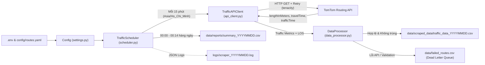

# Tài Liệu Kỹ Thuật — Traffic Scraper (`traffic_scraper`)

Tài liệu này mô tả kiến trúc hệ thống, luồng xử lý dữ liệu, đặc tả module, cấu hình, cơ chế xử lý lỗi và hướng dẫn vận hành/kiểm thử cho hệ thống thu thập dữ liệu giao thông **Traffic Scraper**.

---

## 1. Tổng quan & Kiến trúc hệ thống

**Traffic Scraper** là dịch vụ backend viết bằng Python, tự động thu thập dữ liệu tốc độ và mức độ ùn tắc giao thông theo thời gian thực trên 10 tuyến đường trọng điểm tại khu vực **TP. Thủ Đức, TP.HCM** thông qua **TomTom Routing API v1**.

### Luồng xử lý dữ liệu (Data Flow)



### Ước lượng tải & Hạn mức API

* **Số lượng tuyến đường**: 10 tuyến (`route_001` đến `route_010`).
* **Chu kỳ polling**: 15 phút/lần → 96 lần/ngày/tuyến → **960 API calls/ngày**.
* **Thời gian thu thập mặc định**: 7 ngày → **6,720 bản ghi** (~1–2 MB CSV).
* **Hạn mức TomTom Free Tier**: 2,500 calls/ngày (mức sử dụng ~38.4%, an toàn).

---

## 2. Đặc tả chi tiết các Module

### 2.1. `config/settings.py` — Quản lý cấu hình
* **`Config`**:
  * Nạp biến môi trường từ `.env` qua `python-dotenv`.
  * Kiểm tra biến bắt buộc `TOMTOM_API_KEY` (từ chối giá trị rỗng hoặc placeholder `your_tomtom_api_key_here`).
  * Đọc `config/routes.yaml` một lần duy nhất (`_load_yaml_config`) và validate tọa độ (`-90 <= lat <= 90`, `-180 <= lng <= 180`) cho từng tuyến.
  * Ưu tiên biến môi trường (`POLLING_INTERVAL_MINUTES`, `COLLECTION_DAYS`) ghi đè lên giá trị trong YAML.
  * `ensure_directories()`: Tự động tạo thư mục lưu CSV, báo cáo và log nếu chưa tồn tại.
* **`get_config()`**: Trả về singleton `Config`.

### 2.2. `src/main.py` — Entry Point
* Đảm bảo thư mục gốc `traffic_scraper/` nằm trong `sys.path` để có thể chạy trực tiếp bằng `python src/main.py` hoặc `python -m src.main`.
* Khởi tạo `Config`, cấu hình `setup_logger(...)`, khởi chạy `TrafficScheduler` và giữ tiến trình sống bằng `run_forever()`.

### 2.3. `src/api_client.py` — TomTom API Client
* **`TrafficAPIClient`**:
  * Endpoint: `https://api.tomtom.com/routing/1/calculateRoute/{origin}:{destination}/json` với `traffic=true`, `avoid=ferries`, `timeout=10s`.
  * **Cơ chế Retry (`tenacity`)**: Tự động thử lại tối đa **3 lần** với exponential backoff (`min=1s`, `max=4s`) khi gặp lỗi mạng `requests.exceptions.RequestException` (bao gồm `Timeout`).
  * **Phân loại lỗi HTTP**: Các mã lỗi `401` (sai API key), `403` (không đủ quyền), `429` (vượt rate limit) và lỗi parse JSON được chuyển thành `TomTomAPIError` (không retry vô ích).
  * **`calculate_traffic_metrics()`**: Tính toán tốc độ hiện tại, tốc độ thông thoáng, tỷ lệ ùn tắc và phân loại LOS.

### 2.4. `src/models.py` — Mô hình dữ liệu & Công thức LOS
* **Dataclasses**:
  * `RouteConfig`: Thông tin cấu hình tuyến đường.
  * `APIResponse`: Dữ liệu thô trích xuất từ TomTom (`distance_meters`, `travel_time_seconds`, `traffic_time_seconds`, `raw_response`).
  * `TrafficData`: Bản ghi chuẩn hoá sẵn sàng ghi CSV.
* **Công thức tính toán**:
  $$\text{current\_speed (km/h)} = \frac{\text{distance\_meters}}{\text{traffic\_time\_seconds}} \times 3.6$$
  $$\text{free\_flow\_speed (km/h)} = \frac{\text{distance\_meters}}{\text{travel\_time\_seconds}} \times 3.6$$
  $$\text{congestion\_ratio} = \frac{\text{current\_speed}}{\text{free\_flow\_speed}}$$
* **Bảng phân loại Level of Service (LOS)**:

| LOS | Ngưỡng `congestion_ratio` | `congestion_level` | Ý nghĩa |
| :--- | :--- | :--- | :--- |
| **A** | $\ge 0.90$ | `Very Low` | Thông thoáng |
| **B** | $\ge 0.75$ | `Low` | Khá thông thoáng |
| **C** | $\ge 0.60$ | `Moderate` | Bình thường |
| **D** | $\ge 0.45$ | `High` | Bắt đầu chậm |
| **E** | $\ge 0.30$ | `Very High` | Kẹt xe |
| **F** | $< 0.30$ | `Extreme` | Kẹt xe nặng |

### 2.5. `src/data_processor.py` — Validate, Deduplicate & Lưu trữ
* **`validate_record()`**: Kiểm tra đủ 12 trường bắt buộc, kiểu dữ liệu, phạm vi tọa độ, tốc độ (`0..200 km/h`), thời gian di chuyển (`> 0`), giá trị LOS (`A`–`F`) và định dạng timestamp ISO8601.
* **`check_duplicate()`**: Chống trùng lặp trong phiên chạy theo khóa `route_id + timestamp`.
* **`save_to_csv()`**: Ghi từng dòng vào `data/scraped_data/traffic_data_YYYYMMDD.csv` (lấy ngày theo `record.timestamp`), tự động thêm header nếu là file mới.
* **`save_failed_route()`**: Ghi các tuyến gặp lỗi (`ValidationError`, `TomTomAPIError`, `UnexpectedError`) vào `data/failed_routes.csv` (Dead Letter Queue).
* **`generate_daily_summary()` & `save_daily_summary()`**: Thống kê số lượt poll thành công trong ngày và xuất ra `data/reports/summary_YYYYMMDD.csv`.

### 2.6. `src/scheduler.py` — Điều phối lịch chạy
* Sử dụng `APScheduler` (`BackgroundScheduler`) với múi giờ `Asia/Ho_Chi_Minh`.
* Thiết lập `end_date` tự động dựa trên `COLLECTION_DAYS` (nếu `> 0`).
* Thực thi poll khởi động ngay khi start, sau đó lặp lại mỗi `interval_minutes`.
* Bắt tín hiệu `SIGINT` và `SIGTERM` để dừng scheduler, đóng HTTP session và ghi log thống kê cuối phiên (`graceful shutdown`).

### 2.7. `src/logger.py` — Structured JSON Logging
* Ghi đồng thời ra console và file xoay vòng theo ngày (`logs/scraper_YYYYMMDD.log`, giữ 7 ngày gần nhất).
* `JSONFormatter` xuất log dạng JSON kèm các trường ngữ cảnh (`route_id`, `current_speed`, `los`, `error_type`, `total_polls`, v.v.).

---

## 3. Đặc tả Schema dữ liệu đầu ra

### Bảng dữ liệu chính (`traffic_data_YYYYMMDD.csv`)

| Cột | Kiểu | Mô tả |
| :--- | :--- | :--- |
| `timestamp` | `string` | Thời điểm poll chuẩn ISO8601 kèm timezone (`+07:00`) |
| `route_id` | `string` | Mã tuyến (VD: `route_001`) |
| `route_name` | `string` | Tên tuyến đường |
| `origin_lat`, `origin_lng` | `float` | Tọa độ điểm đầu |
| `dest_lat`, `dest_lng` | `float` | Tọa độ điểm cuối |
| `current_speed` | `float` | Tốc độ thực tế hiện tại (km/h) |
| `free_flow_speed` | `float` | Tốc độ thông thoáng lý tưởng (km/h) |
| `travel_time_seconds` | `int` | Thời gian di chuyển thực tế có xét giao thông (giây) |
| `congestion_level` | `string` | Mức độ ùn tắc (`Very Low` → `Extreme`) |
| `los` | `string` | Level of Service (`A` → `F`) |

### Bảng Dead Letter Queue (`failed_routes.csv`)

| Cột | Kiểu | Mô tả |
| :--- | :--- | :--- |
| `timestamp` | `string` | Thời điểm xảy ra lỗi (ISO8601) |
| `route_id` | `string` | Mã tuyến lỗi |
| `route_name` | `string` | Tên tuyến đường |
| `error_type` | `string` | Loại lỗi (`TomTomAPIError`, `ValidationError`, `UnexpectedError`) |
| `error_message` | `string` | Chi tiết thông báo lỗi |
| `retry_attempts` | `int` | Số lần đã thử lại |

---

## 4. Cấu hình & Biến môi trường

| Biến môi trường (`.env`) | Mặc định | Mô tả |
| :--- | :--- | :--- |
| `TOMTOM_API_KEY` | *(bắt buộc)* | API Key của TomTom Routing API |
| `LOG_LEVEL` | `INFO` | Mức log (`DEBUG`, `INFO`, `WARNING`, `ERROR`) |
| `DATA_DIR` | `data/scraped_data` | Thư mục lưu CSV dữ liệu giao thông |
| `LOGS_DIR` | `logs` | Thư mục lưu log |
| `COLLECTION_DAYS` | `7` | Số ngày thu thập dữ liệu (ghi đè `routes.yaml`) |
| `POLLING_INTERVAL_MINUTES` | `15` | Chu kỳ poll tính bằng phút (ghi đè `routes.yaml`) |

---

## 5. Vận hành & Kiểm thử

### Chạy ứng dụng
```bash
cd traffic_scraper
python -m venv .venv
.venv\Scripts\activate      # Windows
pip install -r requirements.txt
cp .env.example .env         # Điền TOMTOM_API_KEY
python src/main.py
```

### Chạy kiểm thử đơn vị (Unit Tests)
Cấu hình `pyproject.toml` đã thiết lập `pythonpath = ["."]` và `testpaths = ["tests"]`:
```bash
cd traffic_scraper
pytest
```
Bộ test hiện kiểm tra:
* `tests/test_api_client.py`: Khởi tạo client, parse response thành công, xử lý lỗi 401/429/timeout, tính toán metrics & LOS.
* `tests/test_data_processor.py`: Validate schema (thiếu trường, sai tọa độ/vận tốc/LOS/timestamp), chống trùng lặp, ghi CSV mới/append, ghi DLQ và tạo báo cáo ngày.
* `tests/test_scheduler.py`: Khởi tạo scheduler, `start()`, xử lý tín hiệu dừng (`SIGINT`), `stop()`, luồng `_poll_all_routes()` và `_generate_daily_summary()`.
